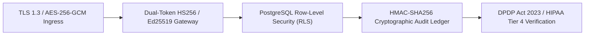

# Security Policy & Responsible Vulnerability Disclosure

GeneWise enforces strict zero-trust security controls, end-to-end cryptographic integrity, and healthcare regulatory compliance designed for Protected Health Information (PHI) and clinical genomics literacy.

---

## Supported Versions

Security updates, hotfixes, and dependency vulnerability patches are actively maintained for the following branches and releases:

| Version | Release Codename | Supported | Patch Policy & SLA |
|:---|:---|:---:|:---|
| `v2.4.x` / `main` | ClinVar & ACMG Genetics Literacy | ✅ Yes | Active production branch; critical CVEs patched within 24h |
| `v2.3.x` | ICU Telemetry & Bi-LSTM Lab | ✅ Yes | Maintenance updates and security backports |
| `< 2.0` | Legacy Monolith Pre-Rebrand | ❌ No | Deprecated; upgrade immediately to `v2.4.0` |

---

## Reporting a Vulnerability

We deeply appreciate responsible disclosure from security researchers, clinical engineers, and the open-source community.

> [!IMPORTANT]
> **Do NOT submit public issues, discussions, or pull requests for undisclosed security vulnerabilities.**
> Public disclosure exposes clinical environments and patient health information to potential risk before a patch is available.

### Preferred Reporting Channels

1. **GitHub Private Security Advisory (Recommended)**:
   - Navigate to [GeneWise Security Advisories](https://github.com/Ranjeet7680/GeneWise/security/advisories).
   - Click **"Report a vulnerability"** to open a confidential advisory directly with repository maintainers.

2. **Direct Security Escalation**:
   - Contact lead maintainer: **Ranjeet Kumar** & security team at `security@genewise.ai` or via secure GPG-encrypted email.

### Vulnerability Report Details

To expedite verification and remediation, please include:
- **Vulnerability Category**: (e.g., Broken Object Level Authorization / IDOR, Cross-Site Scripting, SQL/NoSQL Injection, ReBAC authorization bypass, Cryptographic signing flaw, or Session fixation).
- **Affected Route or Service**: Specific API path (e.g., `/api/v1/auth`, `/api/v1/clinical-decision-support`, `/api/v1/family-genetics`), Next.js route, or database layer.
- **Reproduction Steps**: Step-by-step instructions or minimal non-destructive Proof of Concept (PoC) payload.
- **Clinical & Privacy Impact**: Potential threat assessment against Protected Health Information (PHI) under **Indian DPDP Act 2023** and **HIPAA Security Rule (45 CFR § 164.312)**.

---

## Vulnerability Handling SLA & Response Timeline

| Phase | Target Timeline | Action Taken |
|:---|:---:|:---|
| **Initial Acknowledgment** | **< 24 Hours** | Maintainers confirm receipt of report and initiate private triage channel. |
| **Triage & Reproducibility** | **< 48 Hours** | Vulnerability reproduced in isolated sandbox; severity assessed via CVSS v3.1. |
| **Hotfix & Patch Development** | **< 72 Hours** | Engineering team implements patch, verifies zero regressions via automated test suite. |
| **Production Rollout** | **< 5 Business Days** | Security advisory published; patch deployed to Vercel production & container registries. |
| **Public Disclosure & CVE** | **Coordinated (90 Days max)** | Public credit attributed to researcher in release notes and security advisory hall of fame. |

---

## Core Security Controls & Architecture Matrix

GeneWise employs a multi-layered defense-in-depth security architecture across all 4 tiers of its platform:

### 1. Cryptographic Authentication & Session Integrity
- **Dual-Token Architecture**: Short-lived (15-minute) HS256 access tokens paired with rotating, cryptographically random refresh tokens stored in `HttpOnly`, `SameSite=Strict`, `Secure` cookies.
- **RFC 6238 TOTP Multi-Factor Authentication**: Zero-external-dependency time-based OTP engine with SHA-256 encrypted single-use emergency recovery codes.
- **Timing-Attack Resistance**: Constant-time byte comparisons (`hmac.compare_digest`) for all password hashes, session cookies, and authentication tokens.

### 2. Relationship-Based Access Control (ReBAC) & Multi-Tenant Isolation
- **Active Care Relationship Verification**: Strict enforcement of `check_active_care_relationship(clinician_id, patient_id)` preventing unauthorized clinician record access or horizontal privilege escalation.
- **PostgreSQL Row-Level Security (RLS)**: Enforced across all **28+ core database tables** guaranteeing tenant-isolated data isolation even in the event of an application-level misconfiguration.
- **Statutory Audit Log Immutability**: All diagnostic sign-offs, CDS triage events, and EHR access operations append to an append-only ledger secured by consecutive HMAC-SHA256 hash chains.

### 3. File Processing & Ingestion Hardening
- **Magic Byte Inspection**: Every uploaded lab report, DICOM image, or PDF document undergoes strict magic-byte validation (`%PDF-`, `\x89PNG`, `\xff\xd8\xff`) prior to buffer parsing to prevent malicious MIME spoofing and polyglot exploits.
- **Private S3 / Supabase Storage Isolation**: Biomarker documents are stored in zero-public-access private buckets accessible strictly through short-lived (300-second) pre-signed URLs.

### 4. Regulatory & Clinical Privacy Compliance
- **Digital Personal Data Protection (DPDP) Act 2023 (India)**: Explicit, granular patient consent management (`has_patient_consent`), purpose-limited processing, right to erasure, and local Indian data residency compliance.
- **HIPAA Security Rule (45 CFR § 164.312)**: Technical safeguards for transmission security (TLS 1.3, AES-256), emergency access procedures, unique user identification, and automated session termination.
- **Educational Non-Diagnostic Boundary**: Strict safety headers and clinical governance banners distinguishing educational genetic risk modeling from licensed in-vitro diagnostic workflows.

---

## Security Research Hall of Fame & Recognition

We publicly recognize and thank researchers who ethically disclose vulnerabilities and help keep the GeneWise clinical intelligence platform secure. Contributors will be credited in our official GitHub Release Notes and Security Hall of Fame.
