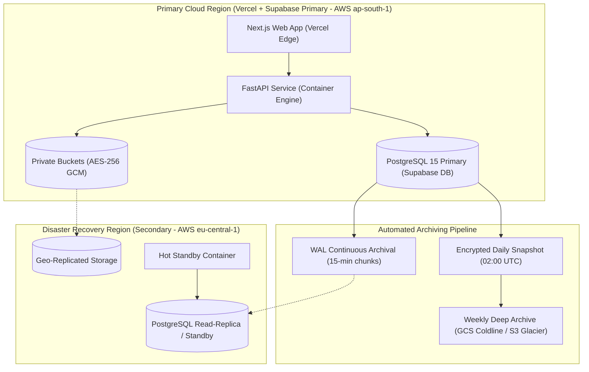
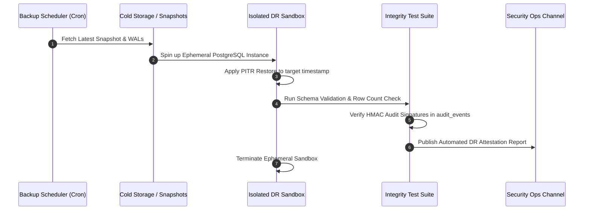

# MediPredict AI — Backup & Disaster Recovery Architecture (DRP)
**Standard Operating Procedure | Document ID: SOP-OPS-2026-008**  
**Version:** 2.0  
**Effective Date:** November 2026  
**Regulatory Framework:** HIPAA Contingency Plan (§ 164.308(a)(7)(ii)), DPDP Act 2023, ISO/IEC 27001:2022 A.8.13

---

## 1. Executive Summary & Clinical Disclaimer

> [!IMPORTANT]
> **STATUTORY HEALTHCARE & CLINICAL DISCLAIMER**  
> *MediPredict AI provides educational genetic and family-history risk awareness. It does not diagnose genetic conditions, determine reproductive outcomes, or replace clinical genetic testing and professional genetic counselling.*

This document details the disaster recovery architecture, automated backup lifecycle, recovery point objective (RPO), recovery time objective (RTO), and multi-region failover runbooks for MediPredict AI's clinical databases, storage buckets, and AI inference runtimes.

---

## 2. Recovery Objectives (RTO & RPO)

| Metric | Target SLA | Definition & Operational Mechanism |
|---|---|---|
| **Recovery Point Objective (RPO)** | **< 15 minutes** | The maximum acceptable data loss in the event of an outage. Achieved via continuous PostgreSQL Write-Ahead Log (WAL) archiving and real-time replica streaming. |
| **Recovery Time Objective (RTO)** | **< 60 minutes** | The maximum acceptable duration to restore full service availability following a catastrophic infrastructure loss. Achieved via automated Terraform / Docker infrastructure provisioning and DNS failover. |

---

## 3. High Availability (HA) & Backup Topology



---

## 4. Backup Cadence & Retention Schedules

### 4.1 Database Backups (Supabase PostgreSQL)
- **Continuous Write-Ahead Logs (WAL)**: Streamed continuously to immutable, air-gapped cloud storage with a 15-minute archive timeout, ensuring Point-In-Time Recovery (PITR) down to the second for the last 30 days.
- **Daily Full Backups**: Automated snapshot executed daily at 02:00 UTC during off-peak hours.
  - Snapshots are encrypted with customer-managed AES-256 keys.
  - Retained for 90 days in primary object storage.
- **Monthly Long-Term Archives**: Full snapshots archived for 7 years to meet HIPAA 45 CFR § 164.316(b)(2)(i) medical records retention statutes.

### 4.2 Storage Buckets (Medical Reports & Genetic Scans)
- Buckets (`medical-reports`, `genetic-records`, `clinical-scans`, `voice-notes`) are configured with:
  - Cross-region multi-bucket replication (e.g., `ap-south-1` to `eu-central-1`).
  - Object versioning enabled to protect against accidental file deletion or ransomware tampering.
  - Immutable WORM (Write Once, Read Many) retention policies on completed laboratory PDF files.

---

## 5. Automated Verification & Restore Drill Protocols

Backups that are not routinely verified for restorability cannot be relied upon during an emergency. MediPredict AI implements automated weekly restore drills:



### Verification Criteria Checklist:
1. **Schema Check**: All 25+ sensitive tables restored with primary keys and constraints intact.
2. **RLS Policy Check**: Confirms `pg_class.relrowsecurity = true` on every table.
3. **Audit Signature Validation**: Selects 1,000 random records from `audit_events` and calculates HMAC SHA-256 with `AUDIT_SIGNING_SECRET` to verify zero data tampering.
4. **Synthetic Test Query**: Executes mock patient and clinician ReBAC queries to verify authorization logic functions correctly.

---

## 6. Disaster Recovery & Failover Runbook

### Step 1: Incident Assessment & Disaster Declaration
- Declared when primary cloud region experiences an unrecoverable failure exceeding 15 minutes.
- Incident Commander notifies IRT and triggers the DR protocol.

### Step 2: Standby Replica Promotion
Promote the hot-standby PostgreSQL database in the secondary region to primary read-write status:
```sql
-- In secondary region database instance:
SELECT pg_promote();
```

### Step 3: Redirect Traffic via DNS / Routing
Update application routing layers to target the secondary endpoints:
- Point backend container environment variables (`DATABASE_URL`, `SUPABASE_URL`) to secondary database cluster.
- Update DNS alias record (e.g., `api.medipredict.health`) to route to secondary load balancer.

### Step 4: Validate RLS and Data Consistency
Run immediate sanity checks before opening traffic to clinicians and patients:
```bash
python -m pytest medipredict-ai/backend/tests/test_security_v2.py -v
```

### Step 5: Post-Failover Communications
- Inform clinical users of the failover via in-app banner.
- Initiate synchronization backfill once the primary cloud region is restored and stabilized.
