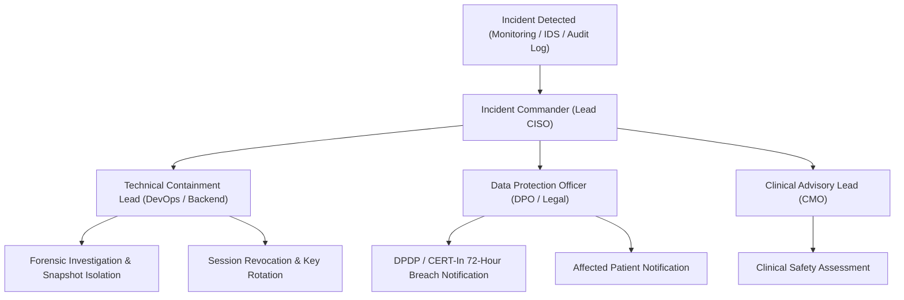

# MediPredict AI — Security Incident Response Plan (SIRP)
**Standard Operating Procedure | Document ID: SOP-SEC-2026-004**  
**Version:** 2.0  
**Effective Date:** November 2026  
**Regulatory Compliance:** DPDP Act 2023 (Sec. 8(6)), HIPAA Security Rule (45 CFR § 164.308(a)(6)(i)), CERT-In Cybersecurity Directives (Ref: No. 20(3)/2022-CERT-In)

---

## 1. Executive Summary & Statutory Disclaimer

> [!IMPORTANT]
> **STATUTORY HEALTHCARE & CLINICAL DISCLAIMER**  
> *MediPredict AI provides educational genetic and family-history risk awareness. It does not diagnose genetic conditions, determine reproductive outcomes, or replace clinical genetic testing and professional genetic counselling.*

This Incident Response Plan defines the formal protocols for detecting, assessing, containing, eradicating, recovering from, and disclosing security and data privacy incidents affecting MediPredict AI infrastructure, Supabase databases, AI inference pipelines, IoT telemetry streams, and private patient/genomic data repositories.

---

## 2. Incident Classification & Severity Matrix

Security events are categorized into four severity tiers based on clinical impact, data sensitivity, and threat scope:

| Severity Level | Response Time (SLA) | Escalate To | Description & Scenario Examples |
|---|---|---|---|
| **P1 - Critical** | **< 15 minutes** | Chief Information Security Officer (CISO), Chief Medical Officer (CMO), Legal Counsel, DPO | Confirmed unauthorized extraction or exposure of genomic data, unencrypted PHI/PII, database compromise, active ransomware, cryptographic key leakage, or compromised service-role token. |
| **P2 - High** | **< 1 hour** | Security Lead, Backend Team Lead, Compliance Officer | Suspicious multi-account brute force login, unauthorized privilege escalation attempt, failed prompt-injection attack attempting jailbreak of clinical tools, or compromised clinician credentials. |
| **P3 - Medium** | **< 4 hours** | Senior DevOps Engineer, Security Analyst | IoT gateway anomalous telemetry rate spikes, single-account lockout thresholds exceeded, minor storage permission misconfiguration detected during automated scans. |
| **P4 - Low** | **< 24 hours** | Security Analyst, DevOps Engineer | Benign port scans, transient authentication token decode errors, automated dependency CVE advisory with low exploitability. |

---

## 3. Incident Response Team (IRT) Roles & Responsibilities



- **Incident Commander (IC)**: Leads incident coordination, directs containment actions, and authorizes emergency system shutdowns.
- **Technical Response Lead**: Directs infrastructure containment, IP blocking, database transaction halts, and forensic disk/memory captures.
- **Data Protection Officer (DPO)**: Determines statutory breach notification triggers under DPDP Act 2023 (Section 8(6)) and CERT-In mandates.
- **Forensics Lead**: Preserves tamper-evident audit logs (`audit_events` with HMAC SHA-256 signatures), verifies hash chain integrity, and secures memory snapshots.
- **Clinical Safety Officer**: Evaluates whether any patient care workflows, triage alerts, or educational risk recommendations were tampered with or corrupted.

---

## 4. Phase-by-Phase Containment & Remediation Runbooks

### Runbook A: Compromised Credentials or Stolen JWT / Session
1. **Immediate Revocation**:
   Execute immediate revocation of all sessions for affected user ID:
   ```bash
   POST /api/v1/auth/sessions/revoke-all
   # Or directly revoke in DB:
   UPDATE user_sessions SET is_active = FALSE, revoked_at = NOW() WHERE user_id = :target_user_id;
   ```
2. **Force Password & MFA Reset**:
   Set `user.mfa_enabled = FALSE`, rotate password hash, and mark `locked_until = NOW() + INTERVAL '1 hour'`.
3. **Audit Inspection**:
   Query `audit_events` filtered by `user_id` to examine all actions performed during the suspicious window:
   ```sql
   SELECT id, action, resource_type, resource_id, ip_address, timestamp, signature 
   FROM audit_events 
   WHERE user_id = :target_user_id 
   ORDER BY timestamp DESC;
   ```

### Runbook B: AI Prompt-Injection & Clinical Tool Abuse
1. **Automated Interception**:
   `AIGuardrailService` automatically blocks requests containing jailbreak tokens (`ignore previous instructions`, `bypass filter`, etc.) and returns an immediate safety refusal.
2. **Threat Logging**:
   `AuditService.log_suspicious_activity` records the attack with threat type `prompt_injection`, severity `high`, and stores the sanitized payload in `suspicious_activities`.
3. **Session Quarantining**:
   If a user repeats prompt injection attempts (>3 occurrences within 10 minutes), the automated rate-limiter suspends the session and temporarily disables AI assistant endpoints for that IP/User.

### Runbook C: Database Intrusion or RLS Policy Bypass Attempt
1. **Connection Severing**:
   If unauthorized queries are detected, terminate active database client connections from unknown IPs via Supabase management console or pg_terminate_backend.
2. **Service Role Key Rotation**:
   Immediately rotate `SUPABASE_SERVICE_ROLE_KEY` and backend `SECRET_KEY` in environment secrets managers (e.g., Vercel, Railway).
3. **RLS Verification**:
   Execute automated RLS audit scripts to confirm `FORCE ROW LEVEL SECURITY` remains active on all 25+ sensitive tables.

---

## 5. DPDP Act 2023 & CERT-In Mandatory Notification Protocols

### 5.1 DPDP Act 2023 (Section 8(6))
- **Timeline**: Notification must be transmitted to the Data Protection Board of India (DPBI) and affected data principals without undue delay and **within 72 hours** of confirmation.
- **Required Report Contents**:
  1. Nature and extent of personal and genetic data impacted.
  2. Estimated number of affected data principals (patients/clinicians).
  3. Description of likely consequences and clinical risks.
  4. Immediate containment actions executed.
  5. Remedial measures recommended for data principals (e.g., credential change, monitoring).
  6. Contact details of the Data Protection Officer (DPO).

### 5.2 CERT-In Directives (April 2022)
- Cybersecurity incidents (such as unauthorized access to IT systems, data breaches, or ransomware) must be reported to **CERT-In within 6 hours** of noticing via email (`incident@cert-in.org.in`) or the CERT-In portal.

---

## 6. Forensics & Chain of Custody

1. **HMAC SHA-256 Audit Verification**:
   All audit records are sealed with tamper-evident HMAC signatures. Run the verification endpoint to validate no records have been altered:
   ```bash
   GET /api/v1/admin/security/audit-verification
   ```
2. **Database Snapshot Freezing**:
   Take an immediate, immutable snapshot of the database prior to applying remediation patches.
3. **Log Immutability Enforcement**:
   The PostgreSQL trigger `trg_audit_immutable` permanently blocks `UPDATE` and `DELETE` queries against `audit_events`. Any attempt to tamper with audit logs raises an exception (`ImmutableTableException`).

---

## 7. Post-Incident Review & Continuous Improvement
- **Within 5 Business Days**: Conduct a blameless post-mortem with engineering, clinical, legal, and product leads.
- **Root Cause Analysis (RCA)**: Document vulnerability vector, timeline, and remediation actions.
- **Regression Testing**: Add dedicated test cases in `backend/tests/test_security_v2.py` replicating the threat pattern to guarantee immunity from recurrence.
